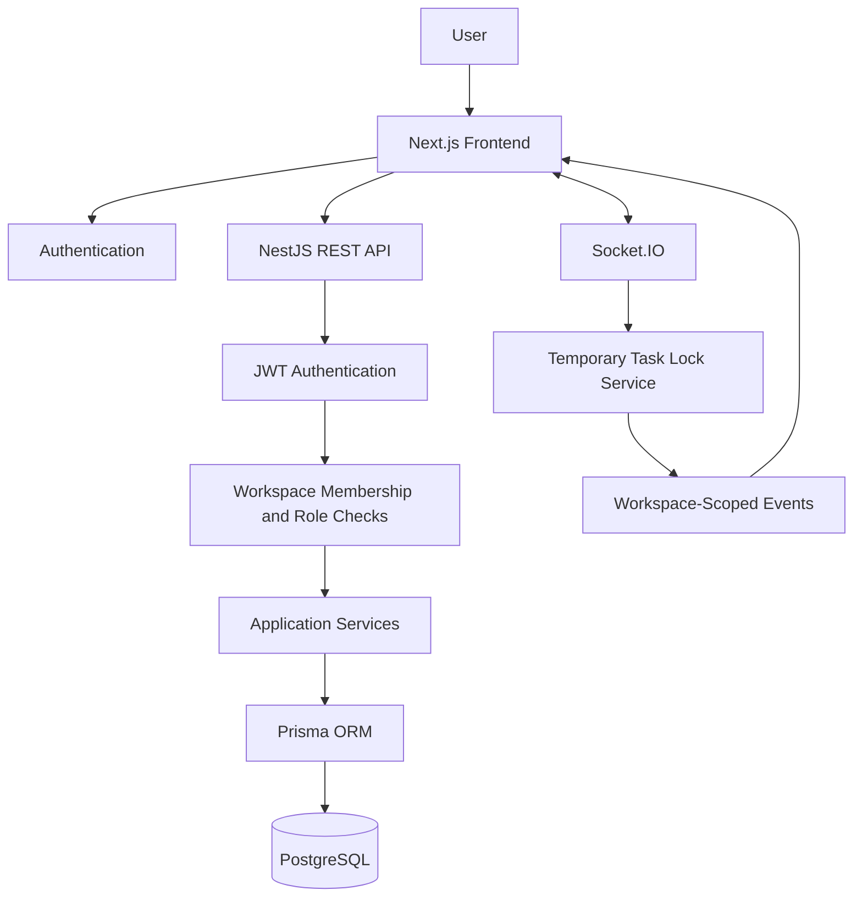
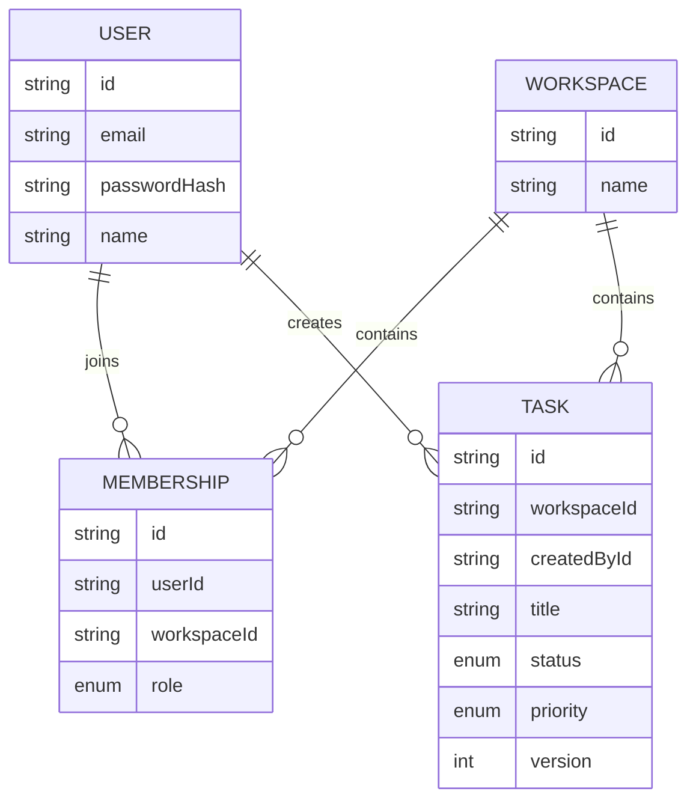

# Task Management System

A multi-tenant task management application built with **Next.js, TypeScript, NestJS, Prisma, and PostgreSQL**. The application allows users to create workspaces, collaborate with other registered users, manage tasks, and receive real-time task editing status through Socket.IO.

## Features

- **Authentication:** User registration, login, JWT-based authentication, and protected routes.
- **Multi-tenant workspaces:** Separate workspaces with isolated task data.
- **Workspace membership:** Add existing registered users to a workspace and assign supported roles.
- **Role-based access control:** Workspace permissions based on `OWNER`, `ADMIN`, and `MEMBER` roles.
- **Task management:** Create, list, search, filter, update, and delete tasks.
- **Task status and priority:** Manage task status and priority.
- **Pagination:** Retrieve tasks in manageable pages.
- **Optimistic concurrency:** Version-based protection against stale concurrent updates.
- **Real-time task editing:** Socket.IO communicates temporary task locks and editing status.
- **Lock recovery:** Temporary locks expire to prevent abandoned editing sessions from blocking a task indefinitely.
- **Input validation:** Validate requests on the backend and frontend.
- **Responsive UI:** Professional interface using Tailwind CSS and Lucide icons.

## Tech Stack

| Layer | Technology |
|---|---|
| Frontend | Next.js App Router, React, TypeScript |
| Styling | Tailwind CSS |
| Icons | Lucide React |
| API communication | Axios |
| Backend | NestJS |
| Database | PostgreSQL |
| ORM | Prisma |
| Authentication | JWT |
| Real-time communication | Socket.IO |
| Validation | NestJS validation pipeline, DTOs, class-validator |
| Testing | Jest, NestJS testing utilities |

## Architecture Overview

The application follows a frontend/backend architecture. The frontend handles user interaction and presentation, while the backend enforces authentication, authorization, workspace isolation, task validation, and concurrency rules.



### Main backend modules

- **Auth:** Registration, login, password verification, and JWT authentication.
- **Workspaces:** Workspace creation and workspace-related operations.
- **Workspace Membership:** Membership verification and member management.
- **Tasks:** Task CRUD, filtering, pagination, version checks, and task authorization.
- **Prisma:** Database access through the Prisma ORM.
- **Task Lock / Socket.IO:** Temporary editing locks and real-time notifications, integrated according to the implemented gateway and service.

## Project Flow

### 1. User registration and login

1. A user registers with an email address and password.
2. The backend validates the request and hashes the password before storing it.
3. The user logs in with their credentials.
4. The backend verifies the credentials and returns an access token.
5. The frontend uses the authentication mechanism supported by the backend for protected API requests.
6. Protected pages redirect unauthenticated users to the login page.

Passwords are never returned in API responses.

### 2. Workspace creation

1. An authenticated user creates a workspace.
2. The backend creates the workspace.
3. The creator is automatically assigned the `OWNER` role through a membership record.
4. The workspace becomes available to its authorized members.

Creating a workspace and creating its initial owner membership should be handled atomically.

### 3. Adding workspace members

The application uses an **existing-user membership flow**, not an invitation system.

1. A user registers for the application.
2. A workspace owner opens the workspace's Members section.
3. The owner enters the registered user's email address.
4. The owner selects an allowed workspace role.
5. The backend validates the requester’s permissions and looks up the existing user.
6. The backend creates the membership linking the user to the workspace.
7. The frontend refreshes the member list and displays success feedback.
8. The added user can access that workspace after authenticating.

If the email does not belong to a registered user, the request is rejected. Duplicate memberships are also rejected.

### 4. Workspace roles

| Role | Intended permissions |
|---|---|
| `OWNER` | Manage the workspace and add `ADMIN` or `MEMBER` users |
| `ADMIN` | Perform permitted administrative operations, including adding `MEMBER` users |
| `MEMBER` | Access the workspace and perform permitted task operations |

Role restrictions must be enforced by the backend, not only by hiding frontend controls.

### 5. Task creation and retrieval

1. An authenticated user selects a workspace.
2. The frontend requests tasks using the selected workspace ID.
3. The backend validates the JWT and verifies workspace membership.
4. The task service scopes every query to the authorized workspace.
5. Search, status, priority, and pagination filters are applied where requested.
6. The frontend displays the resulting tasks and pagination metadata.

A user cannot access another workspace's tasks merely by changing the workspace ID in a request.

### 6. Task updates and concurrency

The application uses optimistic concurrency control to prevent stale updates.

1. The frontend loads a task and its current version.
2. The user edits the task.
3. The update request includes the expected task version.
4. The backend performs a conditional update using the task ID, workspace ID, and expected version.
5. If the version matches, the update succeeds and the version increments.
6. If another update has already changed the task, the stale request is rejected with a conflict response.

This protects data integrity even when multiple users attempt to update the same task.

### 7. Real-time task editing locks

Socket.IO provides an additional coordination layer to reduce unnecessary editing attempts.

1. A user opens a task for editing.
2. The backend authenticates the user, checks workspace membership, and attempts to acquire a temporary lock.
3. If the lock is available, editing is permitted and other workspace clients receive a lock event.
4. Other users see the current editor and cannot start editing the locked task through the normal UI.
5. On successful save or explicit cancellation, the lock is released and an unlock event is emitted.
6. If a user closes the browser or disconnects unexpectedly, the temporary lock expires according to the configured TTL.
7. The existing optimistic concurrency check remains the final safeguard against stale writes.

**Important:** The backend must enforce lock ownership on protected writes. A disabled frontend button alone is not a security control.

If the lock implementation uses in-memory storage, locks are local to a single backend instance and are lost on restart. Multiple backend instances would require shared lock storage.

## Data Model Overview

The core data model contains four main entities.



### Tenant isolation

The `Membership` entity connects users to workspaces and stores their workspace-specific roles.

The unique constraint on `(userId, workspaceId)` prevents a user from being added to the same workspace more than once.

Every workspace-scoped task operation must include the authorized `workspaceId`. The backend performs the authorization checks before returning or modifying workspace data.

## API Overview

The following routes reflect the documented backend contract. Verify the final controllers for any additional endpoints or differences.

| Method | Endpoint | Purpose |
|---|---|---|
| `POST` | `/auth/register` | Register a user |
| `POST` | `/auth/login` | Authenticate a user |
| `POST` | `/workspaces` | Create a workspace |
| `GET` | `/workspaces/:workspaceId/access` | Verify workspace access |
| `POST` | `/workspaces/:workspaceId/members` | Add an existing user to a workspace |
| `POST` | `/workspaces/:workspaceId/tasks` | Create a task |
| `GET` | `/workspaces/:workspaceId/tasks` | List and filter tasks |
| `GET` | `/workspaces/:workspaceId/tasks/:taskId` | Retrieve a task |
| `PATCH` | `/workspaces/:workspaceId/tasks/:taskId?version=:version` | Update a task with version checking |
| `DELETE` | `/workspaces/:workspaceId/tasks/:taskId` | Delete a task |

Task listing supports the filters and pagination parameters implemented by the backend, including search, status, priority, page, and limit.

### Common HTTP responses

- `400 Bad Request` — invalid input or missing required parameters.
- `401 Unauthorized` — missing, invalid, or expired authentication.
- `403 Forbidden` — insufficient workspace access or permissions.
- `404 Not Found` — requested resource does not exist in the applicable scope.
- `409 Conflict` — duplicate membership or stale task version, depending on the operation.
- `500 Internal Server Error` — unexpected server failure.

Socket.IO events are documented separately from REST endpoints. Refer to the actual gateway implementation for the event names and payloads used by the running application.

## Getting Started

### Prerequisites

Install the following:

- Node.js compatible with the project configuration
- npm
- PostgreSQL database or the configured PostgreSQL hosting service

### 1. Clone the repository

```bash
git clone <repository-url>
cd <repository-directory>
```

### 2. Configure the backend

Navigate to the backend directory if the repository uses a separate backend folder.

```bash
npm install
```

Create the backend `.env` file using the variable names expected by the existing project. Configure the database URLs and JWT secret using your own values.

For a Prisma configuration that distinguishes runtime and direct database connections, the environment may contain:

```dotenv
DATABASE_URL="your-runtime-database-url"
DIRECT_URL="your-direct-database-url"
JWT_SECRET="your-long-random-secret"
```

Use the actual variable names required by the repository. Do not commit `.env` or real secrets.

### 3. Run database migrations

For the existing Prisma configuration, run the migration command supported by the project's scripts and Prisma setup. For example, if the project uses Prisma 6 with a configured direct migration URL:

```bash
npx prisma migrate deploy
npx prisma generate
```

Use `prisma migrate dev` only in a development environment where creating migrations is intended. Do not run destructive database commands against production data.

### 4. Start the backend

```bash
npm run start:dev
```

Use the actual backend port configured by the project. Confirm the server starts successfully and the health endpoint responds if one is configured.

### 5. Configure and start the frontend

Navigate to the frontend directory:

```bash
cd frontend
npm install
```

Create the frontend `.env.local` using the variable names expected by the application. For example:

```dotenv
NEXT_PUBLIC_API_URL="http://localhost:3000"
```

Replace the example URL with the actual backend URL and port. Configure the Socket.IO URL separately only if the implementation requires it.

Start the frontend:

```bash
npm run dev
```

Open the local URL printed by Next.js in the terminal.

**Note:** If the backend and frontend use different local origins, configure CORS and authentication credentials according to the actual backend implementation.

## Testing

Run the scripts configured in each package.

### Backend

```bash
npm run build
npm run lint
npm test -- --runInBand
NODE_OPTIONS=--experimental-vm-modules npm run test:e2e -- --runInBand
```

The E2E command above applies to the existing test configuration if it still requires Node's experimental VM modules.

### Frontend

```bash
npm run build
npm run lint
```

Run any configured frontend type-check or test scripts as well.

### Recommended manual verification

- Register and log in as two different users.
- Create a workspace as the first user.
- Add the second registered user through the Members form.
- Verify that the added user can access the workspace.
- Confirm that a non-member cannot access workspace tasks.
- Test task creation, filtering, pagination, updates, and deletion.
- Open the same task in two sessions and verify lock acquisition and rejection.
- Test save, cancel, and abandoned-lock expiry.
- Verify that stale task versions return the expected conflict response.
- Verify that unauthorized users cannot add workspace members.

## Project Structure

The repository may contain separate backend and frontend directories. The frontend follows a feature-based structure, with shared UI components and common utilities separated from feature-specific API logic.

```text
project/
├── backend/
│   ├── src/
│   │   ├── auth/
│   │   ├── workspaces/
│   │   ├── workspace-membership/
│   │   ├── tasks/
│   │   └── ...
│   ├── prisma/
│   └── package.json
└── frontend/
    ├── src/
    │   ├── app/
    │   ├── components/
    │   ├── features/
    │   │   ├── auth/
    │   │   ├── workspaces/
    │   │   ├── members/
    │   │   └── tasks/
    │   ├── lib/
    │   ├── providers/
    │   └── types/
    └── package.json
```

Adapt the paths above to the actual repository layout.

## Design Decisions and Limitations

- Workspace membership is explicit: registering an account does not automatically grant access to an existing workspace.
- The member-add flow requires the target user to have registered already.
- The backend remains the authority for tenant isolation and role-based authorization.
- Optimistic concurrency and temporary task locks serve different purposes: locks reduce conflicting editing attempts, while version checks protect against stale writes.
- In-memory locks are suitable only for a single backend instance unless the implementation uses shared storage.
- Email invitations, email delivery, and distributed locking are outside the scope of this MVP unless separately implemented.

## Future Improvements

Potential improvements include:

- Workspace member removal and role updates
- Invitation workflows
- Shared lock storage for multiple backend instances
- More extensive integration tests
- Audit logging and activity history
- Deployment automation and monitoring

These are optional future enhancements, not assumed to be implemented in the current version.

## License

Add the project's chosen license before distributing the application.
